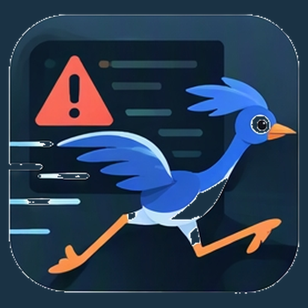
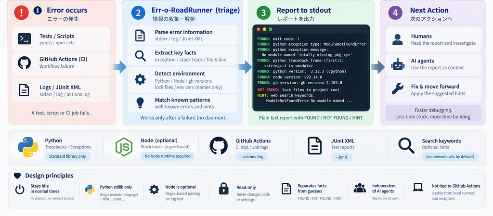
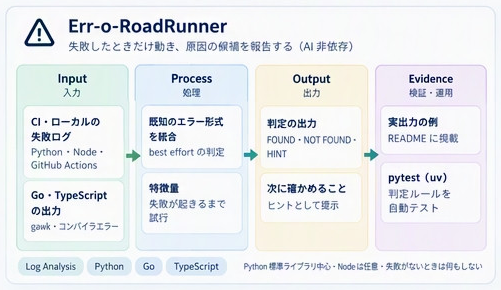
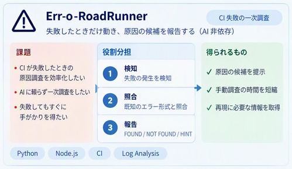

<p align="center">
  
</p>

# Err-o-RoadRunner

Err-o-RoadRunner is a tool that does nothing in normal times. It starts working only after an error has happened. The name combines "Error" and "Road Runner".

Researching the cause of a Python, Node, Go or TypeScript failure, or a GitHub Actions CI failure, currently takes a lot of time. Most error messages are well known, and a web search often turns up hints. This project automates that first investigation **without depending on an AI agent**. It lists what it found and what it did not find on stdout, as a plain report.

<p align="center">
  
</p>

*The diagram shows the core `triage` flow; `sentinel` adds always-on monitoring and escalation on top. The “single module triage.py” label reflects the diagram’s original scope.*

*Icon and concept artwork were generated with Microsoft 365 Copilot.*

## Concept overview



The supplied diagram summarizes the failure-triggered, read-only triage flow. Matching is best effort: hints are not verified root causes, and the tool does not repair code or run a resident monitor. See the current CLI and supported inputs below.

### Challenges, responsibilities and intended outcomes



This complementary supplied panel shows the challenges, roles and intended outcomes alongside the flow above. Detection relies on failure information passed by the caller or wrapper, not background monitoring. Investigation time savings are a design goal, not a measured guarantee. The optional `sentinel` wrapper now available in the CLI provides light capture for an explicitly wrapped command and escalates on failure; the two supplied panels are not a complete inventory of that wrapper’s behavior.

## What it does

- It is woken up when a test, script or CI job fails, from a runner or a wrapper (or when **`sentinel`** detects a failure while lightly monitoring a command).
- It reads the information related to the failure, such as stderr, the exit code, JUnit XML and logs.
- It extracts what it can locally, for example:
  - the exception type, the message and the first and last stack frames
  - the related file and line
  - the Python, Node and gh versions, the lock files and the environment variables (names only)
  - any known patterns found
- It writes a report to stdout, one line per item, using these labels:
  - `FOUND: ...`
  - `NOT FOUND: ...`
  - `HINT: ...`
- It can optionally attach web search keywords for the error message (no network calls by default).

## Design principles (draft)

1. **Light until escalation:** plain `triage` stays off until invoked; the optional **`sentinel`** wrapper keeps only a small ring buffer and redacted env snapshot while a command runs, then runs full triage when something fails.
2. **Python standard library only:** the entry points are root-level modules (`triage.py`, `sentinel.py`, `squad.py`); their shared helpers (`actions_log`, `junit_redact`, `project_version`) live in the `errlib/` package, so import them as `errlib.junit_redact` and so on.
3. **Node is optional:** Node stack parsing is regex-based on log text; no Node runtime is required for triage.
4. **Read-only:** it never changes code or settings, and it never posts or sends anything.
5. **Separates facts from guesses:** it shows `FOUND` and `NOT FOUND` explicitly, and labels inferences as `HINT`.
6. **Independent of AI agents:** the report can be read by humans and by agents alike, and the tool works on its own.
7. **Not tied to GitHub Actions:** it is meant to be called from local runners and wrappers, and Actions is not required.

## Status

**Current slice:** read-only triage for Python tracebacks, Node stacks, Go panics and compiler errors, TypeScript compiler diagnostics, JUnit XML (pytest including rewritten `assert` / `DID NOT RAISE` / `import file mismatch`, Playwright reporter blocks, Flutter test descriptions), `flutter test --machine` JSON lines (`--test-events`), and downloaded GitHub Actions job logs (`--actions-log`). The JUnit rules are measured against the harvested failure corpus (`tests/fixtures/junit_corpus`, 458 cases from 24 repositories as of 2026-11-07; `scripts/classify_junit_corpus.py` reports 435 well handled / 23 partial). Go and TypeScript detection is best effort and reported as `HINT`. Summarize a downloaded CI artifact zip (or directory / single XML or JSON) in place with `digest` (JUnit counts and failing cases, receipt JSON fields, extension counts for everything else). Wrap commands with **`sentinel`** for always-on light capture and automatic escalation plus JSON for agents (`docs/sentinel-report-schema.md`).

## CLI usage

Install the distribution as **`err-o-roadrunner`** (PyPI-style name; matches the `err-o-roadrunner` console script):

```bash
uv sync
```

After installing, run:

```bash
uv run err-o-roadrunner --exit-code "$?" --stderr /path/to/stderr.txt --junit reports/junit.xml
```

### Version string policy

`--version` and `triage.__version__` resolve in this order:

1. **`pyproject.toml` next to `triage.py`** when the file is readable UTF-8, parses as TOML with stdlib `tomllib`, `[project]` name matches `err-o-roadrunner` under [PEP 503](https://peps.python.org/pep-0503/) normalization, and `version` is a non-empty string after stripping.
2. **Installed distribution metadata** for `err-o-roadrunner` (for example after `pip install`).
3. **`unknown`** when neither source is usable.

Importing `triage` never crashes on version lookup; if the version is `unknown`, `--version` prints `err-o-roadrunner unknown` (exit code 0) and all other CLI behaviour is unchanged.

Or as a module:

```bash
python3 triage.py --exit-code 1 --log failure.log --project-root .
```

### Entry point

Use `erroroadrunner.py` or the installed `erroroadrunner` command as the main
entry point. It delegates to the existing triage implementation; the package
includes its supporting modules. This entry point is not yet a standalone
single-file distribution. The existing `err-o-roadrunner` command and
`triage.py` remain available.

### Paste an error directly

Pass ordinary error words directly without quotes. The text is analyzed by the
same parser as `--stderr`:

```bash
python3 erroroadrunner.py ModuleNotFoundError: No module named example
python3 triage.py 'Traceback (most recent call last):
  File "app.py", line 1, in <module>
    raise ValueError("bad input")
ValueError: bad input'
```

For multiline text or shell-sensitive characters, run `python3 erroroadrunner.py --paste`,
paste the error, then press Ctrl-D on Unix/macOS or Ctrl-Z then Enter on Windows.
For direct arguments, the shell processes characters such as `|`, `>`, `$`, `*`,
parentheses and quotes first; use `--paste` to preserve them.
Use `--` before a message starting with `-`. Direct text and `--stderr` cannot
be combined; `--log` and `--junit` can still supply additional evidence.
Command arguments can appear in shell history and process listings, so use
`--stderr -` and standard input for sensitive error text.

### Artifact digest (CI zip / directory)

Bound summary of a downloaded Actions artifact without extracting it:

```bash
python3 -S triage.py digest artifacts.zip
python3 -S triage.py digest junit-dir/ results.xml --limit 5 --width 300
python3 -S triage.py digest evidence.zip --json route-audit.json --keys stage,failed_step
```

Per JUnit XML: one counts line and one `FAIL class::name: message` line per failing testcase (`--limit`, `--width`). Matching receipt JSON (`route-audit.json`, `*receipt*.json` by default) prints only `--keys` fields. Other members are counted by extension (`--list` names them). Oversize members, malformed XML/JSON, and unsafe XML (DOCTYPE/ENTITY) are reported without aborting the whole run. These unverifiable inputs are counted separately from failing testcases and cause exit code `2`.

| Digest exit code | Meaning |
|------------------|---------|
| `0` | No failing testcase |
| `1` | At least one failing testcase |
| `2` | Input error or unverifiable input (missing path, bad zip, malformed/unsafe XML or JSON, or oversized member) |

### Shared browser-evidence failure aggregation

`digest` also reads BrowserTestKit `btk-evidence-gif/2` receipts named
`browser.json` (or selected with `--json GLOB`). It aggregates failed shots across
consumer directories/archives alongside JUnit failures, prints the source, shot,
URL, redacted errors and recorded consumer commit, and checks summary counts
against individual shot statuses. Exit codes are 0 for no reported failures,
1 for failures, and 2 for malformed/inconsistent input. Generic JSON fields remain
informational. This does not verify GIF pixels, build provenance, freshness or
required repository coverage; supply all expected current-attempt inputs.

```bash
python -S /path/to/pinned/Err-o-RoadRunner/triage.py digest artifacts/*/browser.json
```

Consumers keep build/server startup and BrowserTestKit plans locally. Use the
existing `sentinel --exit-mode child --report-json ... -- COMMAND ...` around each
recorder to preserve command/timeout failures, including failures before a receipt
can be written. Keep its original exit status in the parent batch: digesting only
available receipts cannot detect a missing attempt. Sentinel writes JSON only on
escalation; absence of its report alone is not evidence of success. Use separate
per-consumer, per-attempt output paths and preserve available logs on failure.

Distribute this support through the existing Err-o-RoadRunner package/console
entrypoint or an explicitly pinned checkout, without copying parsers into the
parent or BrowserTestKit. No new runtime dependency is needed. For feedback,
reduce real failures to redacted fixture inputs and expected reports in this
repository's tests; keep app selectors and startup logic in their owner.

| Flag | Purpose |
|------|---------|
| `--exit-code N` | Exit code from the failed command |
| `--stderr PATH` | Stderr capture file (`-` for stdin) |
| `--log PATH` | Log file (same safety rules as stderr) |
| `--actions-log PATH` | Downloaded GitHub Actions job log (`gh run view --log`) |
| `--junit PATH` | JUnit XML file (repeatable) |
| `--test-events PATH` | JSON lines from `flutter test --machine` / `dart test --reporter json` (repeatable); carries the exception block that the Flutter JUnit XML drops |
| `--project-root DIR` | Directory checked for lock files (default: `.`) |

### Exit codes

| Code | Meaning |
|------|---------|
| `0` | Triage finished and the report was printed |
| `2` | Invalid CLI usage (also used by `digest` for input errors) |

The default triage mode always exits `0` after printing a report. The `digest` subcommand exits `1` when JUnit reports failing testcases and `2` when any digest input cannot be verified. Input problems take precedence when both conditions occur.

Triage does not re-raise the original failure; it always aims to print a report instead of crashing.

### Sentinel wrapper (stop on exit 0, go otherwise)

Logic is **inverted** from “treat non-zero as failure”:

- **stop:** wrapped command exits `0` with no timeout, signal, or JUnit failure — sentinel returns immediately. The classifier and JSON report **do not run** (minimal normal-path cost).
- **go:** anything else (non-zero exit, timeout, signal, JUnit failure/error, wrapper error) — full triage runs and an optional JSON report is emitted.

By default (`--exit-mode child`), the process exit code is still the **wrapped command’s** code (CI-safe; timeout → `124`, not found → `127`, not executable → `126`). For agents, `--exit-mode signal` uses RoadRunner codes: `0` = stop (no investigation), `1` = go (investigation ran). Exit `0` with only a traceback on stderr stays **stop** unless you pass **`--go-on-stderr-traceback`**. See **`docs/sentinel-exit-codes.md`**.

```bash
uv run err-o-roadrunner sentinel --report-json /tmp/sentinel.json --print-triage --summary -- \
  uv run pytest -q tests/test_triage.py
```

See **`docs/sentinel-report-schema.md`** for the stable `sentinel-report/v1` JSON fields (written only on **go**), including optional `fix_candidates`, `groups`, `records`, `squads`, `hypotheses`, and stdout `--format` / `--tb` / `--group-by` options. Parallel **error squads** (`--squads`, default `code,history`) are documented in **`docs/sentinel-squads.md`** (Japanese). Pytest option alignment is documented in **`docs/pytest-options-survey.md`** (Japanese).

**Example (Python failure, trimmed JSON)**

Command:

```bash
python3 triage.py sentinel --report-json /tmp/sentinel.json --print-triage -- \
  python3 -c "raise RuntimeError('demo failure')"
```

Fragment of `/tmp/sentinel.json`:

```json
{
  "schema": "sentinel-report/v1",
  "mode": "escalated",
  "escalation_reasons": ["non_zero_exit"],
  "command": {
    "reproduce_command": "python3 -c 'raise RuntimeError('\"'\"'demo failure'\"'\"')'"
  },
  "capture": {
    "stderr_tail": "RuntimeError: demo failure\n"
  },
  "triage": {
    "found": [
      "exit code: 1",
      "python exception type: RuntimeError",
      "python exception message: demo failure"
    ],
    "hints": [
      "web search keywords: RuntimeError demo failure"
    ]
  },
  "next_investigation_steps": [
    "Reproduce locally with the same Python version and lock files.",
    "Use HINT web search keywords before deeper code archaeology."
  ]
}
```

## Real report examples

These samples were captured by running the real CLI on real failures (see `tests/fixtures/readme/` and `tests/test_readme_golden.py`). Paths appear as `<repo>`; runtime version lines match the machine that recorded them.

### 1. Python ModuleNotFoundError

*FOUND names the missing module; HINT suggests search terms.*

**Command**

```bash
python3 triage.py --exit-code 1 --stderr tests/fixtures/readme/inputs/python_module_not_found.stderr --project-root tests/fixtures/readme/empty_root
```

**Input (trimmed)**

```text
Traceback (most recent call last):
  File "<string>", line 1, in <module>
ModuleNotFoundError: No module named 'totally_missing_pkg_xyz'
```

**Report (stdout)**

```text
FOUND: exit code: 1
FOUND: python exception type: ModuleNotFoundError
FOUND: python exception message: No module named 'totally_missing_pkg_xyz'
FOUND: python traceback frame (first): <string>:1 in <module>
FOUND: python traceback frame (last): <string>:1 in <module>
FOUND: python traceback frame count: 1
FOUND: python version: 3.12.3 (cpython)
FOUND: node version: v22.14.0
FOUND: gh version: gh version 2.102.0 (2026-09-30)
FOUND: environment variable count: 38
FOUND: environment variable names: AGENT_TRANSCRIPTS, CARGO_HOME, CURSOR_AGENT, CURSOR_AGENT_SOCKET, CURSOR_CONVERSATION_ID, CURSOR_REQUEST_ID, CURSOR_RIPGREP_PATH, CURSOR_SPAWN_CWD_HOP, CURSOR_WORKLOAD_CGROUP, DISPLAY, EXEC_DAEMON_STARTUP_TRACEPARENT, FORCE_COLOR, GH_TELEMETRY, GIT_DISCOVERY_ACROSS_FILESYSTEM, GIT_LFS_SKIP_SMUDGE, HOME, LANG, LC_ALL, NO_COLOR, NVM_BIN, NVM_CD_FLAGS, NVM_DIR, NVM_INC, OLDPWD, PATH, PS1, PWD, RUSTUP_HOME, RUST_VERSION, SHELL, SHLVL, TERM, USER, VNC_DPI, VNC_RESOLUTION, _, _ZO_DOCTOR, __CURSOR_SANDBOX_ENV_RESTORE
NOT FOUND: lock files in project root
HINT: web search keywords: ModuleNotFoundError No module named 'totally_missing_pkg_xyz'
```

### 2. Python ImportError

*FOUND captures ImportError and the import stack frame.*

**Command**

```bash
python3 triage.py --exit-code 1 --stderr tests/fixtures/readme/inputs/python_import_error.stderr --project-root tests/fixtures/readme/empty_root
```

**Input (trimmed)**

```text
Traceback (most recent call last):
  File "<repo>/tests/fixtures/readme/inputs/_import_err_helper.py", line 1, in <module>
    from json import ThisNameDoesNotExist
ImportError: cannot import name 'ThisNameDoesNotExist' from 'json' (/usr/lib/python3.12/json/__init__.py)
```

**Report (stdout)**

```text
FOUND: exit code: 1
FOUND: python exception type: ImportError
FOUND: python exception message: cannot import name 'ThisNameDoesNotExist' from 'json' (/usr/lib/python3.12/json/__init__.py)
FOUND: python traceback frame (first): <repo>/tests/fixtures/readme/inputs/_import_err_helper.py:1 in <module>
FOUND: python traceback frame (last): <repo>/tests/fixtures/readme/inputs/_import_err_helper.py:1 in <module>
FOUND: python traceback frame count: 1
FOUND: python version: 3.12.3 (cpython)
FOUND: node version: v22.14.0
FOUND: gh version: gh version 2.102.0 (2026-09-30)
FOUND: environment variable count: 38
FOUND: environment variable names: AGENT_TRANSCRIPTS, CARGO_HOME, CURSOR_AGENT, CURSOR_AGENT_SOCKET, CURSOR_CONVERSATION_ID, CURSOR_REQUEST_ID, CURSOR_RIPGREP_PATH, CURSOR_SPAWN_CWD_HOP, CURSOR_WORKLOAD_CGROUP, DISPLAY, EXEC_DAEMON_STARTUP_TRACEPARENT, FORCE_COLOR, GH_TELEMETRY, GIT_DISCOVERY_ACROSS_FILESYSTEM, GIT_LFS_SKIP_SMUDGE, HOME, LANG, LC_ALL, NO_COLOR, NVM_BIN, NVM_CD_FLAGS, NVM_DIR, NVM_INC, OLDPWD, PATH, PS1, PWD, RUSTUP_HOME, RUST_VERSION, SHELL, SHLVL, TERM, USER, VNC_DPI, VNC_RESOLUTION, _, _ZO_DOCTOR, __CURSOR_SANDBOX_ENV_RESTORE
NOT FOUND: lock files in project root
HINT: web search keywords: ImportError cannot import name 'ThisNameDoesNotExist' from 'json' (/usr/lib/python3.12/json/__init__.py)
```

### 3. Python chained exceptions

*FOUND reports both blocks; primary vs chained labels separate causes.*

**Command**

```bash
python3 triage.py --exit-code 1 --stderr tests/fixtures/readme/inputs/python_chained.stderr --project-root tests/fixtures/readme/empty_root
```

**Input (trimmed)**

```text
Traceback (most recent call last):
  File "<repo>/tests/fixtures/readme/inputs/chained.py", line 2, in <module>
    1 / 0
    ~~^~~
ZeroDivisionError: division by zero

The above exception was the direct cause of the following exception:

...
```

**Report (stdout)**

```text
FOUND: exit code: 1
FOUND: python chained traceback blocks: 2
FOUND: python exception type (primary): ZeroDivisionError
FOUND: python exception message (primary): division by zero
FOUND: python traceback frame (first) (primary): <repo>/tests/fixtures/readme/inputs/chained.py:2 in <module>
FOUND: python traceback frame (last) (primary): <repo>/tests/fixtures/readme/inputs/chained.py:2 in <module>
FOUND: python traceback frame count (primary): 1
FOUND: python exception type (chained-1): ValueError
FOUND: python exception message (chained-1): while handling
FOUND: python traceback frame (first) (chained-1): <repo>/tests/fixtures/readme/inputs/chained.py:4 in <module>
FOUND: python traceback frame (last) (chained-1): <repo>/tests/fixtures/readme/inputs/chained.py:4 in <module>
FOUND: python traceback frame count (chained-1): 1
FOUND: python version: 3.12.3 (cpython)
FOUND: node version: v22.14.0
FOUND: gh version: gh version 2.102.0 (2026-09-30)
FOUND: environment variable count: 38
FOUND: environment variable names: AGENT_TRANSCRIPTS, CARGO_HOME, CURSOR_AGENT, CURSOR_AGENT_SOCKET, CURSOR_CONVERSATION_ID, CURSOR_REQUEST_ID, CURSOR_RIPGREP_PATH, CURSOR_SPAWN_CWD_HOP, CURSOR_WORKLOAD_CGROUP, DISPLAY, EXEC_DAEMON_STARTUP_TRACEPARENT, FORCE_COLOR, GH_TELEMETRY, GIT_DISCOVERY_ACROSS_FILESYSTEM, GIT_LFS_SKIP_SMUDGE, HOME, LANG, LC_ALL, NO_COLOR, NVM_BIN, NVM_CD_FLAGS, NVM_DIR, NVM_INC, OLDPWD, PATH, PS1, PWD, RUSTUP_HOME, RUST_VERSION, SHELL, SHLVL, TERM, USER, VNC_DPI, VNC_RESOLUTION, _, _ZO_DOCTOR, __CURSOR_SANDBOX_ENV_RESTORE
NOT FOUND: lock files in project root
HINT: web search keywords: ValueError while handling
```

### 4. Python SyntaxError

*FOUND reports SyntaxError even without a full traceback header.*

**Command**

```bash
python3 triage.py --exit-code 1 --stderr tests/fixtures/readme/inputs/python_syntax_error.stderr --project-root tests/fixtures/readme/empty_root
```

**Input (trimmed)**

```text
  File "<repo>/tests/fixtures/readme/inputs/bad_syntax.py", line 1
    print('unclosed
          ^
SyntaxError: unterminated string literal (detected at line 1)
```

**Report (stdout)**

```text
FOUND: exit code: 1
FOUND: python exception type: SyntaxError
FOUND: python exception message: unterminated string literal (detected at line 1)
FOUND: python version: 3.12.3 (cpython)
FOUND: node version: v22.14.0
FOUND: gh version: gh version 2.102.0 (2026-09-30)
FOUND: environment variable count: 38
FOUND: environment variable names: AGENT_TRANSCRIPTS, CARGO_HOME, CURSOR_AGENT, CURSOR_AGENT_SOCKET, CURSOR_CONVERSATION_ID, CURSOR_REQUEST_ID, CURSOR_RIPGREP_PATH, CURSOR_SPAWN_CWD_HOP, CURSOR_WORKLOAD_CGROUP, DISPLAY, EXEC_DAEMON_STARTUP_TRACEPARENT, FORCE_COLOR, GH_TELEMETRY, GIT_DISCOVERY_ACROSS_FILESYSTEM, GIT_LFS_SKIP_SMUDGE, HOME, LANG, LC_ALL, NO_COLOR, NVM_BIN, NVM_CD_FLAGS, NVM_DIR, NVM_INC, OLDPWD, PATH, PS1, PWD, RUSTUP_HOME, RUST_VERSION, SHELL, SHLVL, TERM, USER, VNC_DPI, VNC_RESOLUTION, _, _ZO_DOCTOR, __CURSOR_SANDBOX_ENV_RESTORE
NOT FOUND: lock files in project root
HINT: web search keywords: SyntaxError unterminated string literal (detected at line 1)
```

### 5. Log line after traceback (INFO)

*HINT records INFO as a trailing colon line, not the exception type.*

**Command**

```bash
python3 triage.py --exit-code 1 --log tests/fixtures/readme/inputs/python_with_info_trailing.log --project-root tests/fixtures/readme/empty_root
```

**Input (trimmed)**

```text
Traceback (most recent call last):
  File "<string>", line 1, in <module>
KeyError: 'missing'
INFO: retrying in 5s
```

**Report (stdout)**

```text
FOUND: exit code: 1
FOUND: python exception type: KeyError
FOUND: python exception message: 'missing'
FOUND: python traceback frame (first): <string>:1 in <module>
FOUND: python traceback frame (last): <string>:1 in <module>
FOUND: python traceback frame count: 1
FOUND: python version: 3.12.3 (cpython)
FOUND: node version: v22.14.0
FOUND: gh version: gh version 2.102.0 (2026-09-30)
FOUND: environment variable count: 38
FOUND: environment variable names: AGENT_TRANSCRIPTS, CARGO_HOME, CURSOR_AGENT, CURSOR_AGENT_SOCKET, CURSOR_CONVERSATION_ID, CURSOR_REQUEST_ID, CURSOR_RIPGREP_PATH, CURSOR_SPAWN_CWD_HOP, CURSOR_WORKLOAD_CGROUP, DISPLAY, EXEC_DAEMON_STARTUP_TRACEPARENT, FORCE_COLOR, GH_TELEMETRY, GIT_DISCOVERY_ACROSS_FILESYSTEM, GIT_LFS_SKIP_SMUDGE, HOME, LANG, LC_ALL, NO_COLOR, NVM_BIN, NVM_CD_FLAGS, NVM_DIR, NVM_INC, OLDPWD, PATH, PS1, PWD, RUSTUP_HOME, RUST_VERSION, SHELL, SHLVL, TERM, USER, VNC_DPI, VNC_RESOLUTION, _, _ZO_DOCTOR, __CURSOR_SANDBOX_ENV_RESTORE
NOT FOUND: lock files in project root
HINT: trailing colon line: INFO: retrying in 5s
HINT: web search keywords: KeyError 'missing'
```

### 6. pytest assertion (JUnit XML)

*FOUND pulls failure text from JUnit without re-running pytest.*

**Command**

```bash
python3 triage.py --exit-code 1 --junit tests/fixtures/readme/inputs/pytest_assertion.junit.xml --project-root tests/fixtures/readme/empty_root
```

**Input (trimmed)**

```text
<?xml version="1.0" encoding="utf-8"?><testsuites name="pytest tests"><testsuite name="pytest" errors="0" failures="0" skipped="0" tests="0" time="0.009" timestamp="2026-10-11T13:44:37.956493+00:00" hostname="cursor" /></testsuites>
```

**Report (stdout)**

```text
FOUND: exit code: 1
FOUND: python version: 3.12.3 (cpython)
FOUND: node version: v22.14.0
FOUND: gh version: gh version 2.102.0 (2026-09-30)
FOUND: environment variable count: 38
FOUND: environment variable names: AGENT_TRANSCRIPTS, CARGO_HOME, CURSOR_AGENT, CURSOR_AGENT_SOCKET, CURSOR_CONVERSATION_ID, CURSOR_REQUEST_ID, CURSOR_RIPGREP_PATH, CURSOR_SPAWN_CWD_HOP, CURSOR_WORKLOAD_CGROUP, DISPLAY, EXEC_DAEMON_STARTUP_TRACEPARENT, FORCE_COLOR, GH_TELEMETRY, GIT_DISCOVERY_ACROSS_FILESYSTEM, GIT_LFS_SKIP_SMUDGE, HOME, LANG, LC_ALL, NO_COLOR, NVM_BIN, NVM_CD_FLAGS, NVM_DIR, NVM_INC, OLDPWD, PATH, PS1, PWD, RUSTUP_HOME, RUST_VERSION, SHELL, SHLVL, TERM, USER, VNC_DPI, VNC_RESOLUTION, _, _ZO_DOCTOR, __CURSOR_SANDBOX_ENV_RESTORE
NOT FOUND: junit failures (<repo>/tests/fixtures/readme/inputs/pytest_assertion.junit.xml)
NOT FOUND: junit errors (<repo>/tests/fixtures/readme/inputs/pytest_assertion.junit.xml)
NOT FOUND: junit skipped (<repo>/tests/fixtures/readme/inputs/pytest_assertion.junit.xml)
NOT FOUND: lock files in project root
```

### 7. Hostile OSC sequences stripped

*Report output contains no escape bytes; exception facts still FOUND.*

**Command**

```bash
python3 triage.py --exit-code 1 --stderr tests/fixtures/readme/inputs/hostile_osc.stderr --project-root tests/fixtures/readme/empty_root
```

**Input (trimmed)**

```text
<OSC-8-bytes>Traceback (most recent call last):
  File "<string>", line 1, in <module>
RuntimeError: hostile demo
```

**Report (stdout)**

```text
FOUND: exit code: 1
FOUND: python exception type: RuntimeError
FOUND: python exception message: hostile demo
FOUND: python traceback frame (first): <string>:1 in <module>
FOUND: python traceback frame (last): <string>:1 in <module>
FOUND: python traceback frame count: 1
FOUND: python version: 3.12.3 (cpython)
FOUND: node version: v22.14.0
FOUND: gh version: gh version 2.102.0 (2026-09-30)
FOUND: environment variable count: 38
FOUND: environment variable names: AGENT_TRANSCRIPTS, CARGO_HOME, CURSOR_AGENT, CURSOR_AGENT_SOCKET, CURSOR_CONVERSATION_ID, CURSOR_REQUEST_ID, CURSOR_RIPGREP_PATH, CURSOR_SPAWN_CWD_HOP, CURSOR_WORKLOAD_CGROUP, DISPLAY, EXEC_DAEMON_STARTUP_TRACEPARENT, FORCE_COLOR, GH_TELEMETRY, GIT_DISCOVERY_ACROSS_FILESYSTEM, GIT_LFS_SKIP_SMUDGE, HOME, LANG, LC_ALL, NO_COLOR, NVM_BIN, NVM_CD_FLAGS, NVM_DIR, NVM_INC, OLDPWD, PATH, PS1, PWD, RUSTUP_HOME, RUST_VERSION, SHELL, SHLVL, TERM, USER, VNC_DPI, VNC_RESOLUTION, _, _ZO_DOCTOR, __CURSOR_SANDBOX_ENV_RESTORE
NOT FOUND: lock files in project root
HINT: web search keywords: RuntimeError hostile demo
```

### 8. Node Module Not Found

*FOUND captures Node headline and stack frames from real node output.*

**Command**

```bash
python3 triage.py --exit-code 1 --log tests/fixtures/readme/inputs/node_module_not_found.stderr --project-root tests/fixtures/readme/empty_root
```

**Input (trimmed)**

```text
Error [ERR_MODULE_NOT_FOUND]: Cannot find package 'missing-xyz-module-123' imported from <repo>/[eval]
    at Object.getPackageJSONURL (node:internal/modules/package_json_reader:268:9)
    at packageResolve (node:internal/modules/esm/resolve:768:81)
    at moduleResolve (node:internal/modules/esm/resolve:854:18)
    at defaultResolve (node:internal/modules/esm/resolve:984:11)
    at ModuleLoader.defaultResolve (node:internal/modules/esm/loader:685:12)
    at #cachedDefaultResolve (node:internal/modules/esm/loader:634:25)
    at ModuleLoader.resolve (node:internal/modules/esm/loader:617:38)
...
```

**Report (stdout)**

```text
FOUND: exit code: 1
FOUND: node error code: ERR_MODULE_NOT_FOUND
FOUND: node stack frame (first): node:internal/modules/package_json_reader:268 in Object.getPackageJSONURL
FOUND: node stack frame (last): node:diagnostics_channel:344 in TracingChannel.tracePromise
FOUND: node stack frame count: 10
FOUND: python version: 3.12.3 (cpython)
FOUND: node version: v22.14.0
FOUND: gh version: gh version 2.102.0 (2026-09-30)
FOUND: environment variable count: 38
FOUND: environment variable names: AGENT_TRANSCRIPTS, CARGO_HOME, CURSOR_AGENT, CURSOR_AGENT_SOCKET, CURSOR_CONVERSATION_ID, CURSOR_REQUEST_ID, CURSOR_RIPGREP_PATH, CURSOR_SPAWN_CWD_HOP, CURSOR_WORKLOAD_CGROUP, DISPLAY, EXEC_DAEMON_STARTUP_TRACEPARENT, FORCE_COLOR, GH_TELEMETRY, GIT_DISCOVERY_ACROSS_FILESYSTEM, GIT_LFS_SKIP_SMUDGE, HOME, LANG, LC_ALL, NO_COLOR, NVM_BIN, NVM_CD_FLAGS, NVM_DIR, NVM_INC, OLDPWD, PATH, PS1, PWD, RUSTUP_HOME, RUST_VERSION, SHELL, SHLVL, TERM, USER, VNC_DPI, VNC_RESOLUTION, _, _ZO_DOCTOR, __CURSOR_SANDBOX_ENV_RESTORE
NOT FOUND: node error headline
NOT FOUND: lock files in project root
HINT: web search keywords: ERR_MODULE_NOT_FOUND
```

More captured scenarios (JUnit mix, hostile symlink refusal, additional Node errors) live under `tests/fixtures/readme/` and are checked by `tests/test_readme_golden.py`.

## Development

Requires Python 3.11 or later.

With uv (the lockfile is `uv.lock`, and CI runs the same commands; CI provisions Python with `astral-sh/setup-uv`, not `actions/setup-python`):

```bash
uv sync --locked
uv run pytest -q tests
```

Tests are grouped with pytest markers: `success`, `failure`, and `adversarial`.

### Component boundaries

- `erroroadrunner.py`: user-facing entry point; imports the analysis backend
  only when invoked and forwards arguments without reimplementing parsing.
- `triage.py`: internal failure parsing, reporting and the `digest` dispatch.
- `errlib/error_input.py`: standalone stdlib helper for recognizing possible
  one-line Python exception names, without CLI or network dependencies.
- `errlib/junit_redact.py` and `errlib/project_version.py`: shared redaction and
  version helpers used by the backend.
- `sentinel.py` and `squad.py`: command monitoring and optional investigation
  helpers. They are loaded for their respective features rather than by the
  entry point at import time.

The packaged distribution includes these components. A genuinely standalone
copy of `erroroadrunner.py` still needs a self-contained core and a clear
boundary for optional features; the current wrapper alone does not provide it.

### Build a standalone Python file

From a complete source checkout, build the standalone file using Python 3.11+:

```bash
python scripts/build_standalone.py dist/ErroRR.py
python dist/ErroRR.py ModuleNotFoundError: No module named example
python dist/ErroRR.py --paste
```

Copy the generated `dist/ErroRR.py` to another directory or machine and
run it with Python 3.11+. It embeds the project-owned stdlib modules at build time;
no network or pip installation is needed. The generator is the maintained source
of the bundled file. The bundle installs an internal import hook while executing
and refuses to run if one of its backend module names is already imported in the
same Python interpreter. Its version can be `unknown` outside an installed
package or checkout. CI still needs to validate cross-platform behavior. The
bundle has not yet been registered in the parent vendor catalog.

OLNM can execute the generated `ErroRR.py` as a child process with an argv
list, or embed its source and call `main(argv)` in a namespace, following its
existing bundled-tool pattern. Namespace execution does not require `__file__`.
The OLNM command itself and source pin have not yet been implemented.

#### Proposed shared packaging path (local prototype)

The existing `scripts/build_standalone.py dist/ErroRR.py` command and OLNM
filename stay unchanged. To package the same generated bytes as a uv tool:

```bash
python scripts/build_uv_tool.py --out dist/uv-tool
uv tool install dist/uv-tool
```

This uses the unmodified common builder pinned from Aoi in `vendor.lock.json`.
The temporary package module is named `erroroadrunner.py` because the shared
builder requires lowercase module names; it is byte-identical to `ErroRR.py`.
Both `erroroadrunner` and `err-o-roadrunner` commands remain available. The
distribution name and version remain `err-o-roadrunner` and `0.6.0`.
There are no Python runtime dependencies; packaging requires setuptools.
The source checkout's multi-file Hatch distribution is unchanged. These are
alternative installation forms of the same distribution, not two packages to
install together. This proposal does not wire OLNM or register the bundle in
the parent vendor catalog. The Aoi consumer record must follow actual adoption.

#### Calling from OLNM and other hosts

To avoid collisions between bundled module names and the host interpreter,
prefer a child process with an argument list. With the existing `cli_args`
module available, the same common runner can be used by other tools too:

```python
import sys
from cli_args import Command, run_command

command = Command((sys.executable, "ErroRR.py", "--paste"))
result = run_command(command, stdin="ValueError: invalid input\n", timeout=20)
print(result.stdout, end="")
print(result.returncode)
```

`run_command` buffers output; it does not provide live streaming. OLNM's
existing subprocess pattern can instead inherit stdin/stdout/stderr for
interactive paste and incremental output. Both approaches avoid shell
interpretation by passing an argument list. `cli_args` is optional for the
standalone file itself. OLNM integration and the source pin are pending.
