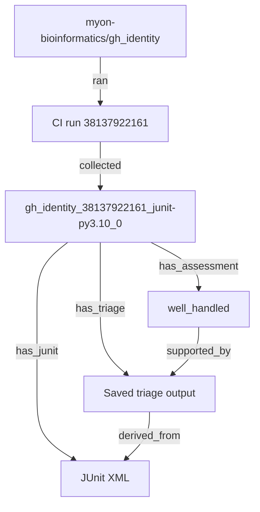

# ErrORR case evidence

Triage assessments describe available failure signals, not confirmed root causes.

## Sources

- [JUnit XML](https://github.com/myon-bioinformatics/Err-o-RoadRunner/blob/main/tests/fixtures/junit_corpus/cases/gh_identity_38137922161_junit-py3.10_0.xml) (SHA-256: `a7112dbed32f0690ba14d8bf01f9d1e641a90bc306d9bb4ee92018edd9073296`)
- [Saved triage output](https://github.com/myon-bioinformatics/Err-o-RoadRunner/blob/main/tests/fixtures/junit_corpus/golden/gh_identity_38137922161_junit-py3.10_0.out) (SHA-256: `3512139ea3d97574aa62da10d84e2716081341ec9fcbb61ef0f2cc1303eedd90`)
- [CI run 38137922161](https://github.com/myon-bioinformatics/gh_identity/actions/runs/38137922161)
