# ErrORR fleet footprint

Point-in-time snapshot (`errorr-footprint/v1`, observed 2026-11-24). Regenerate with
`python3 -S scripts/usage_graph.py from-checkout` from the repository root.
The diagram is ONTO `knowledgegraph.graph_mermaid` output. It is not a live counter.

```mermaid
flowchart TD
  n0["corpus harvest"]
  n1["digest"]
  n2["sentinel"]
  n3["triage"]
  n4["partial"]
  n5["well_handled"]
  n6["Aoi"]
  n7["BlueProbe"]
  n8["BrowserTestKit"]
  n9["DRAgoWing"]
  n10["Err-o-RoadRunner"]
  n11["FluidFullSpeedSimulation"]
  n12["Ironmate"]
  n13["NagoyAction"]
  n14["ONTO"]
  n15["OnTautoLogy"]
  n16["OneLaunchNumerousModules"]
  n17["PySaiyanWeBoo"]
  n18["PythDRagoras"]
  n19["QueRyu"]
  n20["SakAnalytics"]
  n21["TalkCompress"]
  n22["TaxOntOy"]
  n23["TopOntoLogy"]
  n24["ascii_artist"]
  n25["browser-test-kit"]
  n26["cli_args"]
  n27["flutter_navigation_basic"]
  n28["gh_identity"]
  n29["markdown"]
  n30["mcp-toolcall-lab"]
  n31["myon-bioinformatics"]
  n32["myon-bioinformatics.github.io"]
  n33["nvd_nist_known_vulns"]
  n34["search_seq_including_spaces"]
  n35["web-ui"]
  n36["xprobe"]
  n37["yourself"]
  n38["Err-o-RoadRunner"]
  n0 -->|"harvests #40;source-list#41;"| n6
  n0 -->|"harvests #40;source-list#41;"| n7
  n0 -->|"harvests #40;source-list#41;"| n8
  n0 -->|"harvests #40;source-list#41;"| n9
  n0 -->|"harvests #40;source-list#41;"| n10
  n0 -->|"harvests #40;source-list#41;"| n11
  n0 -->|"harvests #40;source-list#41;"| n12
  n0 -->|"harvests #40;source-list#41;"| n13
  n0 -->|"harvests #40;source-list#41;"| n14
  n0 -->|"harvests #40;source-list#41;"| n15
  n0 -->|"harvests #40;source-list#41;"| n16
  n0 -->|"harvests #40;source-list#41;"| n17
  n0 -->|"harvests #40;source-list#41;"| n18
  n0 -->|"harvests #40;source-list#41;"| n19
  n0 -->|"harvests #40;source-list#41;"| n20
  n0 -->|"harvests #40;source-list#41;"| n21
  n0 -->|"harvests #40;source-list#41;"| n22
  n0 -->|"harvests #40;source-list#41;"| n23
  n0 -->|"harvests #40;source-list#41;"| n24
  n0 -->|"harvests #40;source-list#41;"| n26
  n0 -->|"harvests #40;source-list#41;"| n27
  n0 -->|"harvests #40;source-list#41;"| n28
  n0 -->|"harvests #40;source-list#41;"| n29
  n0 -->|"harvests #40;source-list#41;"| n30
  n0 -->|"harvests #40;source-list#41;"| n31
  n0 -->|"harvests #40;source-list#41;"| n32
  n0 -->|"harvests #40;source-list#41;"| n33
  n0 -->|"harvests #40;source-list#41;"| n34
  n0 -->|"harvests #40;source-list#41;"| n36
  n0 -->|"harvests #40;source-list#41;"| n37
  n6 -->|"triaged #40;75#41;"| n5
  n7 -->|"triaged #40;5#41;"| n5
  n8 -->|"observed_use #40;documented#41;"| n1
  n8 -->|"observed_use #40;documented#41;"| n2
  n8 -->|"triaged #40;5#41;"| n5
  n9 -->|"triaged #40;20#41;"| n5
  n10 -->|"observed_use #40;harvest-step#41;"| n3
  n10 -->|"observed_use #40;workflow#41;"| n0
  n10 -->|"triaged #40;27#41;"| n5
  n12 -->|"triaged #40;48#41;"| n5
  n13 -->|"triaged #40;25#41;"| n5
  n17 -->|"triaged #40;12#41;"| n5
  n18 -->|"triaged #40;30#41;"| n5
  n19 -->|"triaged #40;1#41;"| n5
  n20 -->|"triaged #40;10#41;"| n5
  n24 -->|"triaged #40;40#41;"| n5
  n25 -->|"same_as #40;renamed#41;"| n8
  n25 -->|"triaged #40;33#41;"| n5
  n26 -->|"triaged #40;15#41;"| n5
  n27 -->|"triaged #40;37#41;"| n5
  n27 -->|"triaged #40;5#41;"| n4
  n28 -->|"triaged #40;49#41;"| n5
  n29 -->|"triaged #40;25#41;"| n5
  n30 -->|"triaged #40;22#41;"| n5
  n31 -->|"observed_use #40;documented#41;"| n1
  n31 -->|"triaged #40;29#41;"| n5
  n32 -->|"observed_use #40;catalog#41;"| n3
  n32 -->|"triaged #40;7#41;"| n5
  n33 -->|"triaged #40;27#41;"| n5
  n34 -->|"triaged #40;2#41;"| n5
  n35 -->|"same_as #40;renamed#41;"| n17
  n35 -->|"triaged #40;41#41;"| n5
  n36 -->|"triaged #40;12#41;"| n5
  n37 -->|"triaged #40;26#41;"| n5
  n38 -->|"exposes"| n0
  n38 -->|"exposes"| n1
  n38 -->|"exposes"| n2
  n38 -->|"exposes"| n3
```

## Triage of harvested JUnit goldens

| | |
| --- | --- |
| manifest rows | 628 |
| duplicate rows collapsed | 0 |
| colliding rows not in the surviving file | 0 |
| historical rows with unavailable evidence | 7 |
| cases | 628 |
| well_handled | 623 |
| partial | 5 |
| unknown | 0 |
| classification.json rows | 628 |

Exception types named on `FOUND: junit pytest exception type` or the first Dart error line:

- AssertionError: 511
- ModuleNotFoundError: 30
- ImportError: 11
- research_digest.DigestError: 10
- ValueError: 9
- Failed: 5
- AttributeError: 4
- StopIteration: 4
- lib/shared/catalog/catalog_search.dart:7:6: Error: Type 'ScreenData' not found.: 4
- SyntaxError: 3
- TypeError: 3
- FileNotFoundError: 2
- RuntimeError: 2
- SetupError: 2
- UnicodeDecodeError: 2
- KeyError: 1
- NameError: 1
- urllib.error.HTTPError: 1

## Repositories in the diagram

| Repository | Harvest source | Cases | Uses |
| --- | --- | --- | --- |
| `myon-bioinformatics/Aoi` | yes | 75 | — |
| `myon-bioinformatics/ascii_artist` | yes | 40 | — |
| `myon-bioinformatics/BlueProbe` | yes | 5 | — |
| `myon-bioinformatics/BrowserTestKit` | yes | 5 | digest (documented), sentinel (documented) |
| `myon-bioinformatics/cli_args` | yes | 15 | — |
| `myon-bioinformatics/DRAgoWing` | yes | 20 | — |
| `myon-bioinformatics/Err-o-RoadRunner` | yes | 27 | triage (harvest-step), corpus-harvest (workflow) |
| `myon-bioinformatics/FluidFullSpeedSimulation` | yes | 0 | — |
| `myon-bioinformatics/flutter_navigation_basic` | yes | 42 | — |
| `myon-bioinformatics/gh_identity` | yes | 49 | — |
| `myon-bioinformatics/Ironmate` | yes | 48 | — |
| `myon-bioinformatics/markdown` | yes | 25 | — |
| `myon-bioinformatics/mcp-toolcall-lab` | yes | 22 | — |
| `myon-bioinformatics/myon-bioinformatics` | yes | 29 | digest (documented) |
| `myon-bioinformatics/myon-bioinformatics.github.io` | yes | 7 | triage (catalog) |
| `myon-bioinformatics/NagoyAction` | yes | 25 | — |
| `myon-bioinformatics/nvd_nist_known_vulns` | yes | 27 | — |
| `myon-bioinformatics/OneLaunchNumerousModules` | yes | 0 | — |
| `myon-bioinformatics/ONTO` | yes | 0 | — |
| `myon-bioinformatics/OnTautoLogy` | yes | 0 | — |
| `myon-bioinformatics/PySaiyanWeBoo` | yes | 12 | — |
| `myon-bioinformatics/PythDRagoras` | yes | 30 | — |
| `myon-bioinformatics/QueRyu` | yes | 1 | — |
| `myon-bioinformatics/SakAnalytics` | yes | 10 | — |
| `myon-bioinformatics/search_seq_including_spaces` | yes | 2 | — |
| `myon-bioinformatics/TalkCompress` | yes | 0 | — |
| `myon-bioinformatics/TaxOntOy` | yes | 0 | — |
| `myon-bioinformatics/TopOntoLogy` | yes | 0 | — |
| `myon-bioinformatics/xprobe` | yes | 12 | — |
| `myon-bioinformatics/yourself` | yes | 26 | — |
| `myon-bioinformatics/browser-test-kit` | no | 33 | — |
| `myon-bioinformatics/web-ui` | no | 41 | — |

## Public inventory with no harvest edge and no triage cases

None.

## Renames recorded on older corpus rows

- `myon-bioinformatics/browser-test-kit` → `myon-bioinformatics/BrowserTestKit`
- `myon-bioinformatics/web-ui` → `myon-bioinformatics/PySaiyanWeBoo`
